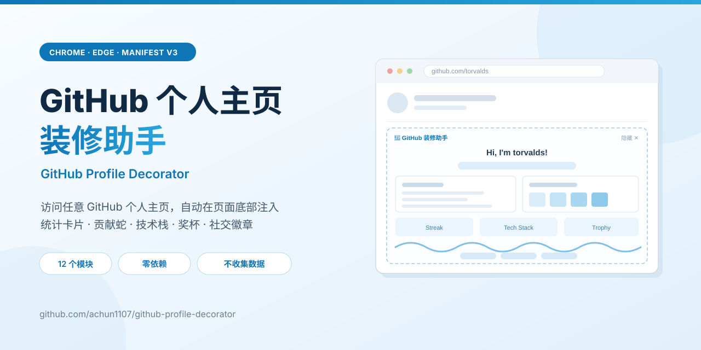
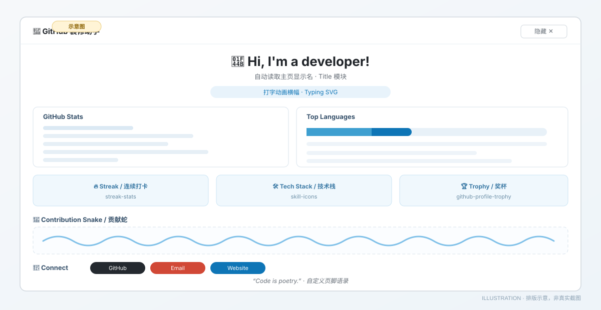

# 🎨 GitHub 个人主页装修助手 / GitHub Profile Decorator



[](https://github.com/achun1107/github-profile-decorator/actions/workflows/validate.yml) [](LICENSE) [](https://github.com/achun1107/github-profile-decorator/releases)

**一个 Chrome / Edge Manifest V3 浏览器扩展**：访问**任意** GitHub 个人主页时，自动在页面底部注入统计卡片、贡献蛇、技术栈图标、成就奖杯与社交徽章。不用写一行 README，也不用改自己的 `<用户名>/<用户名>` 仓库。

| | |
| --- | --- |
| **这是什么** | 浏览器扩展（不是网页工具、不是 README 生成器），装好后自动生效 |
| **给谁用** | 想让 GitHub Profile 更有辨识度、又不想手写徽章拼装的开发者 |
| **装好要多久** | clone 一次 + 4 次点击，约 30 秒 |
| **隐私** | 无后端、无分析脚本，配置只存在你的浏览器里 |
| **当前状态** | 尚未上架 Chrome Web Store，通过开发者模式加载（[上架清单](STORE_LISTING.md)） |

> **English**: A `manifest-v3` `chrome-extension` / `edge-extension` that decorates any GitHub profile with `github-readme-stats`, `streak-stats`, `skill-icons`, contribution snake and social badges. Keywords: GitHub profile decorator, profile widgets, contribution graph, profile README.

[官网 / Demo](https://achun1107.github.io/github-profile-decorator/) · [快速开始](#30-秒快速开始) · [模块](#-注入的装饰模块) · [FAQ](#-faq--故障排查) · [更新日志](CHANGELOG.md) · [隐私政策](PRIVACY.md)

---

## 30 秒快速开始

```bash
git clone https://github.com/achun1107/github-profile-decorator.git
```

1. 打开 `chrome://extensions`（Edge 为 `edge://extensions`）。
2. 打开右上角**开发者模式**，点**加载已解压的扩展程序**，选中刚 clone 的目录。
3. 访问 <https://github.com/torvalds>。

页面**底部**会立刻出现装饰区。点工具栏里的扩展图标，可以开关模块、换主题、改文案。



> 上图是**排版示意图**，说明装饰区的结构与模块位置，不是截图。真实渲染截图会在 Chrome Web Store 上架时补齐（见 `STORE_LISTING.md`）。

---

## ✨ 注入的装饰模块

12 个模块，全部可在配置弹窗里独立开关：

| 模块 | 说明 | 数据来源 |
| --- | --- | --- |
| 欢迎标题 | 自动读取主页显示名，生成欢迎语 | GitHub 页面 DOM |
| 打字动画 | 动态文字横幅 | readme-typing-svg |
| 访客徽章 | 主页访问量计数 | komarev |
| 统计卡片 | Star / Commit / PR 概览 + 语言分布 | github-readme-stats |
| 连续打卡 | Streak 连续贡献 | streak-stats |
| 技术栈 | skill-icons 图标拼装 | skillicons.dev |
| 🏆 奖杯 | 成就奖杯 | github-profile-trophy |
| 📈 活跃图 | 贡献活跃度图谱 | github-readme-activity-graph |
| ⏱️ WakaTime | 编码时长（需在弹窗填 WakaTime 用户名） | github-readme-stats |
| 贡献蛇 | 目标用户自己仓库生成的动画（需配置 Action，见下） | Platane/snk |
| 社交徽章 | GitHub / 邮箱 / 网站 / Twitter | img.shields.io |
| 页脚语录 | 自定义名言 | 本地配置 |

所有卡片都是**公开第三方徽章服务的图片**，扩展本身没有后端、不收集也不上传数据。配置保存在浏览器的 `chrome.storage.sync`：登录 Chrome 账号时由 Chrome 自身同步，扩展开发者接触不到。详见 [PRIVACY.md](PRIVACY.md)。

> 支持 GitHub 的 Turbo SPA 路由——通过站内链接切到另一个人的主页，装饰区会自动重新注入，不会叠加。

## 📦 安装（开发者模式加载）

扩展未上架商店，需手动加载解压目录：

1. 下载本仓库：`git clone https://github.com/achun1107/github-profile-decorator.git`
2. 打开浏览器扩展页：Chrome `chrome://extensions` / Edge `edge://extensions`。
3. 右上角打开 **开发者模式（Developer mode）**。
4. 点击 **加载已解压的扩展程序（Load unpacked）**，选择本仓库目录。
5. 固定扩展图标到工具栏。访问任意 GitHub **个人主页**（如 `https://github.com/torvalds`）即可看到装饰区。

> 不需要 `npm install`，没有构建步骤。改代码后回扩展页点「重新加载」再刷新 GitHub 页面即可。

## ⚙️ 配置

点击工具栏的扩展图标打开配置页，改动**实时保存、立即生效**：

- **总开关**：是否启用注入
- **12 个模块开关**：见上表
- **统计卡片主题**：`radical` / `tokyonight` / `vue` / `nightowl` / `buefy` / `gruvbox` / `dracula` / `merko`
- **技术栈图标**：skill-icons 名称，逗号分隔（如 `js,ts,react,python`）
- **打字动画文案**：每行一条
- **页脚语录**：自定义文字
- **社交链接**：邮箱 / 网站域名 / Twitter 用户名 / WakaTime 用户名
- GitHub 徽章自动使用**当前访问的用户名**，无需填写

## 🐍 启用贡献蛇（目标用户侧）

贡献蛇由**被装修的那个 GitHub 账号**自己的主页仓库生成。在该账号的 `<用户名>/<用户名>` 仓库里放：

```yaml
# .github/workflows/snake.yml
name: Generate Snake
on:
  schedule: [{ cron: "0 0 * * *" }]
  workflow_dispatch:
  push: { branches: [main] }
permissions: { contents: write }
jobs:
  generate:
    runs-on: ubuntu-latest
    steps:
      - uses: actions/checkout@v4
      - uses: Platane/snk@v3
        with:
          github_user_name: 用户名
          outputs: |
            dist/github-contribution-snake.svg
            dist/github-contribution-snake-dark.svg?palette=github-dark
      - uses: crazy-max/ghaction-github-pages@v4
        with: { target_branch: output, build_dir: dist }
        env: { GITHUB_TOKEN: ${{ secrets.GITHUB_TOKEN }} }
```

提交后 Action 会把动画推到 `output` 分支，扩展自动引用。**未配置时扩展显示一段提示文字而不是破图**——这是正常现象。

## 🔒 权限与隐私

| 权限 | 用途 |
| --- | --- |
| `storage` | 保存模块开关、主题与文案到浏览器本地 |
| `host_permissions: https://github.com/*` | 仅在 GitHub 页面运行内容脚本注入装饰，不访问其他网站 |

不请求 `tabs`、`<all_urls>`、Cookie 或网络拦截权限。完整说明见 [PRIVACY.md](PRIVACY.md) 与 [SECURITY.md](SECURITY.md)。

## ❓ FAQ / 故障排查

**装饰区没出现？**
按顺序排查：① 确认访问的是**个人主页**（`github.com/用户名`），仓库页 / 组织页不会注入——扩展靠页面的 `octolytics-dimension-user_login` meta 识别主页；② 确认弹窗里「启用注入」是开着的；③ 扩展页点「重新加载」，再强制刷新 GitHub 页面；④ 若 GitHub 改版导致选择器失效，请带浏览器版本和控制台报错[提 Issue](https://github.com/achun1107/github-profile-decorator/issues/new/choose)。

**切换账号主页后装饰区没更新 / 出现两份？**
已适配 Turbo SPA（`turbo:render`、`pjax:end`、`MutationObserver`），切换后有约 0.3–0.5 秒延迟属正常。若你点过装饰区右上角的「隐藏 ✕」，在当前路径下会保持隐藏，换个路径会自动恢复。

**某些卡片是空白 / 少了几张？**
第三方徽章服务偶发限流或不可用，扩展会自动隐藏加载失败的图片以免破图。稍后刷新，或在弹窗里关掉该模块。

**贡献蛇位置显示一段提示文字？**
说明目标用户没配置生成 Action，按上一节操作即可；这不是扩展故障。

**WakaTime 卡片不显示？**
需在弹窗「社交链接」里填 WakaTime 用户名，且该账号的编码时长统计是可公开读取的。留空时模块不渲染。

**改了配置没生效？**
配置写入 `chrome.storage.sync` 后会触发重新注入；没反应就刷新页面。深色模式下若卡片偏亮，可在弹窗换 `dracula` / `tokyonight` 等主题。

**会不会上传我的数据 / 能不能上商店？**
无后端、无分析脚本，详见 `PRIVACY.md`。商店尚未上架，当前只能用开发者模式加载；上架进度见 `STORE_LISTING.md`。

**想加模块 / 改代码？**
零依赖零构建，本地加载即可调试。见 [CONTRIBUTING.md](CONTRIBUTING.md)，AI 助手请先读 [AGENTS.md](AGENTS.md)。

## 📚 文档索引

| 文档 | 内容 |
| --- | --- |
| [AGENTS.md](AGENTS.md) / [llms.txt](llms.txt) | AI 协作规范与 LLM 内容清单 |
| [CONTRIBUTING.md](CONTRIBUTING.md) | 本地调试、自检清单、提交规范 |
| [SECURITY.md](SECURITY.md) | 漏洞报告渠道 |
| [PRIVACY.md](PRIVACY.md) | 隐私政策（商店上架用） |
| [STORE_LISTING.md](STORE_LISTING.md) | 商店文案与待补素材 |
| [CHANGELOG.md](CHANGELOG.md) | 版本变更 |
| [官网](https://achun1107.github.io/github-profile-decorator/) | 产品介绍与安装入口 |

## 📄 License

[MIT](LICENSE) © 2026 achun1107
